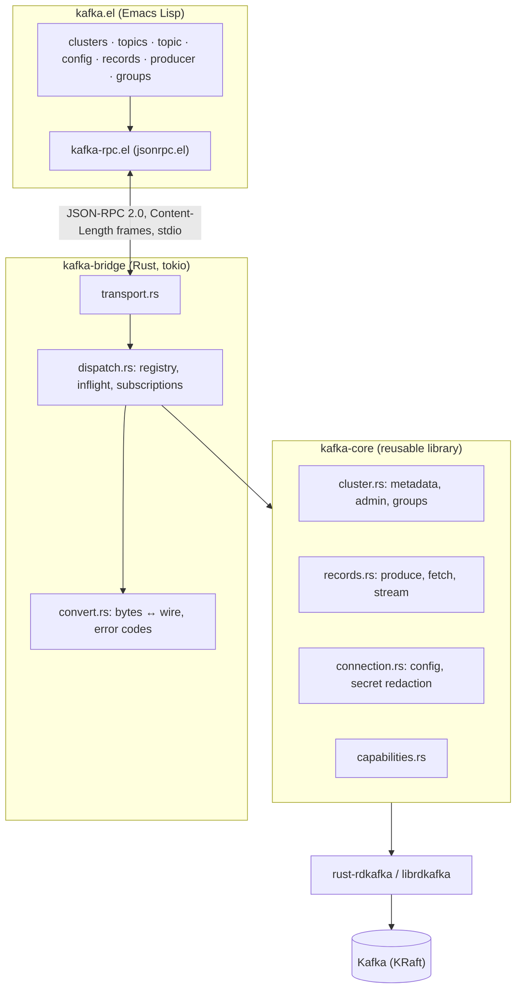

# ARCHITECTURE.md

## Crate boundaries

| Crate | Depends on | Must not depend on |
|---|---|---|
| `kafka-rpc-protocol` | serde | Kafka clients, tokio |
| `kafka-core` | rdkafka, tokio | Emacs, JSON-RPC, `kafka-rpc-protocol` |
| `kafka-wire` | kafka-protocol, tokio, OpenSSL | Emacs, JSON-RPC |
| `kafka-schema-registry` | reqwest, Avro, JSON Schema, Protobuf codecs | Emacs, JSON-RPC |
| `kafka-connect-rest` | reqwest | Emacs, JSON-RPC |
| `kafka-bridge` | core, protocol, wire and REST adapters | |

`kafka-core::ffi` wraps librdkafka admin APIs omitted by rust-rdkafka 0.39.
RAII owns each native queue, request options and result event. `kafka-wire`
negotiates broker API versions for operations absent even from librdkafka.
The bridge's `ext` modules bind these clients to connection write guards.

## Concurrency model

* One bridge process per Emacs. Requests are handled concurrently on tokio,
  so a slow broker never blocks other requests or other clusters.
* librdkafka metadata/watermark/group calls are blocking and run on
  `spawn_blocking`.
* Each live stream owns one OS thread running a `BaseConsumer` poll loop. It
  communicates through a 2-slot bounded channel and a credit semaphore, so its
  memory is bounded by `batchSize × 2` plus librdkafka's fetch buffers.
* The outgoing writer has a 256-message bounded queue. When Emacs stops
  reading, back-pressure propagates to stream threads, which stop polling.

## Safety invariants

1. **Inspection never commits.** All reads use a consumer with a unique
   `kafka.el-inspect-*` group id, `enable.auto.commit=false`, manual
   `assign`, and no `commit` call anywhere. Verified in `e2e::full_workflow`.
2. **Describing a group never joins it.** The native list-consumer-group-offsets
   admin API fetches committed partitions directly. No all-topic scan or
   inspection consumer joins the application group.
3. **Read-only is enforced in the core**, before any network I/O, as well as
   in the UI. A UI bug cannot bypass it.
4. **Secrets do not leave memory.** `ConnectionConfig`'s `Debug` redacts them.
   The bridge never echoes connect params. Sensitive broker config values are
   replaced with `null`.
5. **Destructive operations need exact confirmation** at the protocol level,
   not only in the UI. Offset resets require preview and an inactive group.
6. **Adapter credentials are connection-scoped.** Disconnect and successful
   profile replacement discard Connect and Registry clients and abort open
   producer sessions. Stdin close and shutdown also abort producer sessions.
7. **Producing transactions do not commit consumer offsets.** Dedicated
   idempotent producers support explicit begin/produce/commit/abort sessions.
   A produce timeout can have an indeterminate delivery outcome, so it is not
   a safe signal to blindly retry a logical record.

## Failure handling

| Failure | Behavior |
|---|---|
| Broker unreachable on connect | bounded overall connection deadline, actionable auth/TLS diagnostics where available |
| Bridge crashes or is killed | Emacs `on-shutdown` clears connection state and marks live buffers "bridge exited". Next command restarts the bridge and reconnects lazily. Tested in `kafka-it-bridge-death-recovers`. |
| Emacs exits / stdin closes | bridge stops all streams, drains its writer, exits |
| Records buffer killed while streaming | `kill-buffer-hook` stops the subscription. Late notifications for unknown buffers also trigger a stop. |
| Malformed frame | parse error with `id: null`; bridge keeps running |
| Oversized frame | bridge exits (stream cannot be resynchronized safely) |
| Multi-resource admin partial failure | error 1005 with per-resource results |
